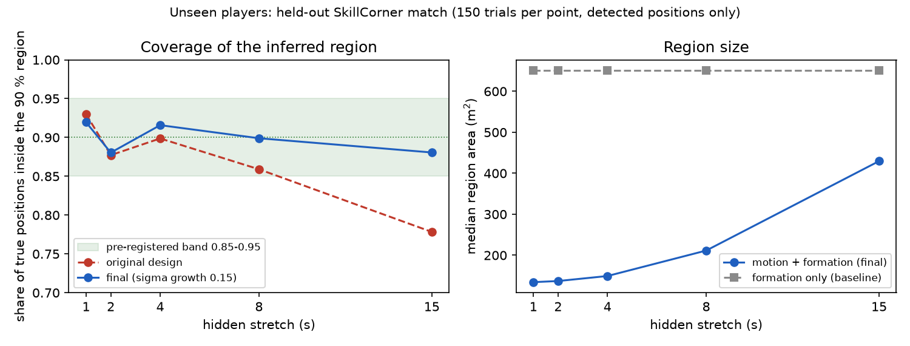
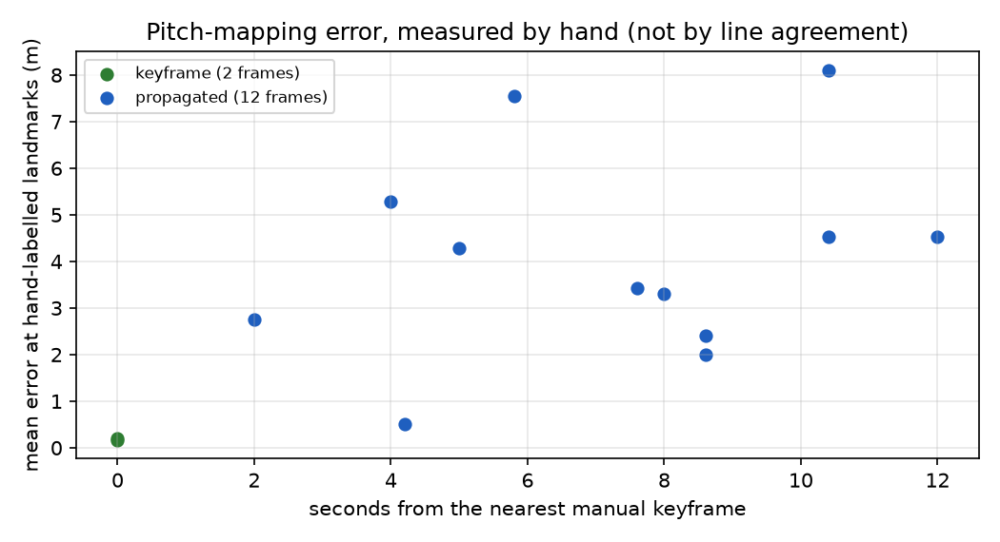
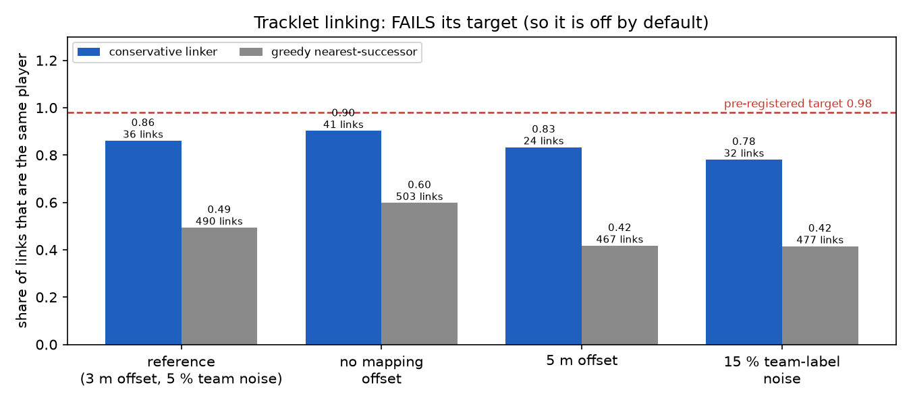
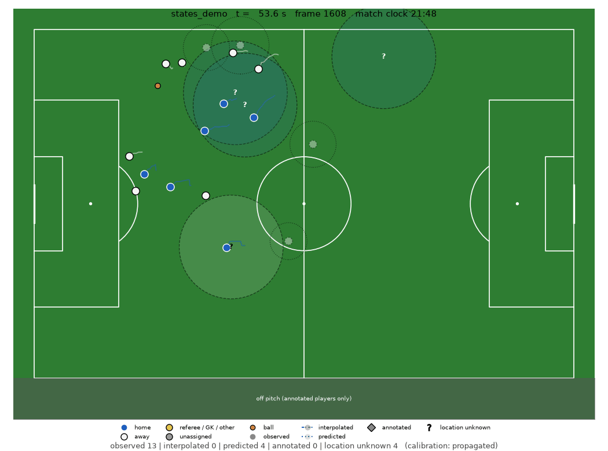
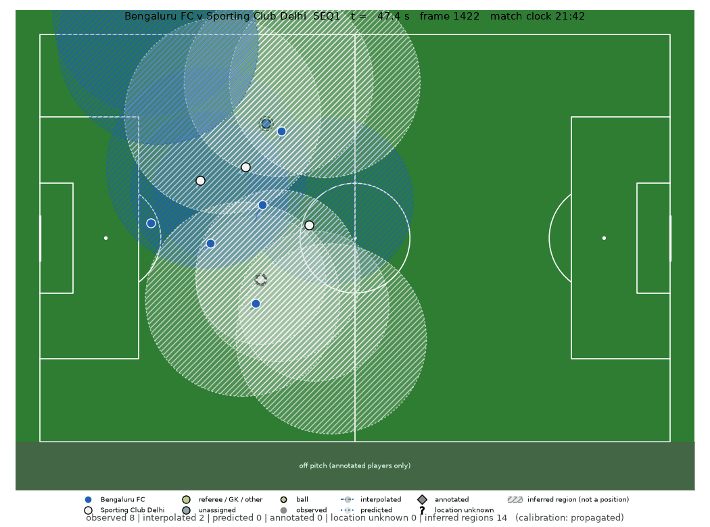

# football-cv-mvp

Broadcast football video → detected and tracked players and ball → 2D pitch coordinates (metres)
→ spatial analytics, exploratory xT, candidate attacking sequences, and an Atomic-VAEP model
trained on public event data. Built and evaluated on one real Indian Super League broadcast clip.

**Status: MVP.** Every output is derived from a single broadcast clip with no ground truth.
Provisional values are labelled as such in the files and the dashboard. Atomic-VAEP on the clip
is **INCOMPLETE** by design: see [Report](#report).

## Pipeline

```
ingest → detect → shots → motion → track → calibrate → identity → reconstruct → regions → analytics → visualize
                                       (atomic_vaep and reconstruction_eval run separately)
```

| stage | does | key output |
|---|---|---|
| ingest | probe and sample the video at 5 fps | `data/manifests/<clip>.json`, frames |
| detect | YOLO11m (COCO) people + ball, FP32, imgsz 1280 | `detections.parquet` |
| shots | cut detection, wide tactical view gate | `shot_table.csv` |
| motion | ORB camera motion between samples, motion segments | `motion_segments.csv` |
| track | ByteTrack people, best ball per frame, torso-colour teams | `track_teams.csv` |
| calibrate | manual keyframes → propagated homography → pitch metres, with rejections | `trajectories.parquet`, `calibration_report.json` |
| reconstruct | fills short gaps in person tracks with a motion model, with provenance, state and uncertainty; never across cuts or uncalibrated frames | `player_states.parquet`, `gaps.parquet` |
| identity | conservative tracklet linking by team, position and kit colour; writes decisions, **not applied by default** (see below) | `artifacts/<clip>/identity/` |
| regions | probable regions for players not in view, labelled `INFERRED`, kept apart from observed positions | `inferred_regions.parquet`, `regions_summary.json` |
| analytics | team shape, ball proximity, ball-zone xT, candidate sequences | `artifacts/<clip>/analytics/` |
| visualize | annotated broadcast, top-down animation, state-aware top-down animation, per-sequence clips | `artifacts/<clip>/videos/` |
| atomic_vaep | socceraction Atomic-VAEP on StatsBomb SPADL stores | `artifacts/atomic_vaep/` |
| reconstruction_eval | masking evaluation of the gap-filling methods | `artifacts/<clip>/reconstruction/masking_eval.csv` |

Design and conventions: [docs/current_architecture.md](docs/current_architecture.md). Audit of the
v0.1 baseline (git tag `baseline-v0.1`): [docs/audit_and_findings.md](docs/audit_and_findings.md).
Table schemas: [docs/data_schemas.md](docs/data_schemas.md).

### Reading the state-aware top-down view

| marker | meaning |
|---|---|
| solid, team colour | observed: detected, tracked and calibrated |
| translucent, dashed edge, ring | interpolated between two observations; ring = 2-sigma |
| faint, dotted edge, ring | predicted from history only (at most 2 s); ring = 2-sigma |
| diamond | manually annotated position |
| `?` in a dashed ring | location unknown; estimate withheld, ring shows how uncertain it is |
| grey band below the touchline | off-pitch region, used by annotated players only |
| red border / `CAMERA CUT` | no calibrated view, or a camera cut; nothing is drawn |
| hatched patch, "inferred region" | a probable region for an unseen player of that team (90 % ellipse). **Not a position.** Thinned so that no more than 11 minus the visible players are drawn per team |

Injury treatment, return to play and confirmed substitution are shown only when a manual annotation
file says so (`reconstruction.annotations_file`); a gap in tracking never produces them.

## Setup

Python 3.11–3.12, a CUDA build of PyTorch already installed (deliberately not a dependency, so pip
cannot swap it for a CPU wheel), and `ffmpeg` on `PATH`.

```bash
python -m venv .venv
.venv/Scripts/pip install -e ".[dev]"
```

The clip is not in the repository (copyrighted broadcast). It is seconds 3120–3480 of the official
full replay, 1280×720 at 30 fps; for example:

```bash
yt-dlp -f "bv*[height<=720]+ba/b[height<=720]" --download-sections "*3120-3480" -o data/raw/isl_bfc_scd_2026-10-10_gw1_section.mp4 https://www.youtube.com/watch?v=gDI508P5F3g
```

YOLO11m weights download on first use. Atomic-VAEP needs the SPADL HDF5 stores from the sibling
`VAEP_Football` project (path in `configs/default.yaml`).

## Run

```bash
python -m football_cv.pipeline all
```

```bash
python -m football_cv.pipeline atomic_vaep
```

```bash
streamlit run app/streamlit_app.py
```

```bash
python -m football_cv.pipeline reconstruct
python -m football_cv.pipeline reconstruction_eval
```

```bash
python -m pytest
```

Any config value can be overridden, e.g. `--set calibration.max_keyframe_dt_s=8`. New calibration
keyframes are added with `scripts/annotate_keyframe.py` (draws candidate line intersections to
name) and `configs/calibration_keyframes.json`.

## Report

Clip: Bengaluru FC v Sporting Club Delhi, ISL 2026-27 GW1, 6 minutes from the official full replay
(1-0 goal, replays, kick-off, open play). Full numbers and method: [docs/evaluation.md](docs/evaluation.md).

### Results at a glance

All figures are drawn from the evaluation files by `scripts/make_figures.py`. None contains broadcast
footage. Passes and failures are both shown.

**Unseen players as probable regions: meets its pre-registered criteria** (held-out SkillCorner match,
detected positions only; [§11.2](docs/evaluation.md)). The red dashed line is the first design, which
failed at 15 s; the blue line is the fix tuned on the other half of the match.



**Pitch mapping: about 4 m off on propagated frames**, measured by hand at held-out landmarks
([§10](docs/evaluation.md)). This is the main accuracy limit of everything drawn on the pitch.



**Identity linking: fails its target and is off by default** ([§11.1](docs/evaluation.md)). It beats
greedy linking by a wide margin but is still not reliable enough to merge tracks.



**State-aware top-down view** (observed, interpolated, predicted and unknown, kept visibly separate; see
the legend above):



**In action** (SEQ1, 47–61 s, the 1-0 goal; 5 frames per second, pitch graphics only, no broadcast pixels):



Solid dots are observed players. Dashed translucent circles are interpolated or predicted positions with
their uncertainty. Hatched patches are inferred regions for players not in view (**not positions**). A
red border means the frame has no calibrated view (a camera cut or close-up), so nothing is drawn. The
regions are large and overlap because the pitch mapping is about 4 m off and the gaps are long (median
858 m² on this clip); this sequence is also marked low confidence (ball seen in 45 % of frames, up to
9 s from a manual keyframe). Re-render with `python scripts/render_demo.py --seq SEQ1`.

The same 14 seconds on the broadcast picture, with player boxes, track ids, the projected pitch lines and
a mini-map: [docs/media/broadcast_overlay_SEQ1.mp4](docs/media/broadcast_overlay_SEQ1.mp4) (2.7 MB; click
through to play). It is a short excerpt of the replay shown for research illustration only; see
[Licences and attribution](#licences-and-attribution).

**Pitch mapping on the broadcast picture** (100 s of play, match clock 23:29 to 25:09, plus the keyframe holds, 1 min 46 s in all):
[docs/media/calibration_demo.mp4](docs/media/calibration_demo.mp4) (9.7 MB; click through to play). Every
frame with a calibrated view shows player boxes with track ids and team colours, the pitch boundary (thick
yellow), the inner markings (red), the projected landmark fix points (yellow dots: corners, penalty box,
six-yard box, D, penalty spot, circle) and the mini-map. Four manual keyframes are held for 1.6 s and show
the hand-clicked landmarks (green +) against where the model projects them (red o). The status bar gives
the calibration state and the measured error for that state.

How to read it honestly: the mapping is near exact only at those keyframes (0.18 m). On the other
calibrated frames it is propagated from the nearest keyframe and is **about 4 m off on average (worst
measured 8.1 m)**, so expect the red lines and dots to sit visibly away from the painted lines, most so far
from a keyframe ([evaluation §10](docs/evaluation.md)). Of the 501 sampled frames, 376 (75 %) have a
calibrated view; close-ups, replays and cuts get no overlay and say so. The clip is 5 frames per second, so
motion is choppy. Re-render with `python scripts/render_calibration_demo.py --start 154 --end 254`.

**What works**

- Players are detected in 98.8 % of sampled frames (median confidence 0.78) and tracked within
  shots; teams are separated by kit colour (blue home, white away; referees and keepers as "other").
- 895 of 1,043 wide-view frames are mapped to pitch metres from 11 manual keyframes. The mapping is
  exact at the keyframes (0.18 m at held-out labelled points) but **about 4 m off on propagated
  frames** (12 hand-labelled frames, 2–12 s from a keyframe: mean 4.1 m, median 3.9 m, worst frame
  8.1 m; [docs/evaluation.md](docs/evaluation.md) §10). The earlier "0.4 m over 4 s" figure came from
  one keyframe pair and an automatic line-agreement score, and was wrong as a statement of pitch error.
  Frames over 12 s from a keyframe are rejected rather than kept.
- Direction of play is measured from the data (home attacks left in this window).
- Team shape of the visible players: median width 34–38 m, depth 20–22 m.
- Missing positions are reconstructed and kept apart from observations: 11,997 observed rows,
  536 interpolated, 2,379 predicted, 1,954 withheld. On a masking test over 75,140 samples, Kalman +
  RTS recovers a hidden 4 s stretch to 1.0 m MAE (linear 1.2 m, last-position hold 3.3 m) with a
  well-calibrated uncertainty. The truth in that test is the pipeline's own smoothed projection, so
  it measures the motion model, not real pitch error ([docs/evaluation.md](docs/evaluation.md) §9).
- Unseen players are shown as inferred regions, not dots. Checked against SkillCorner open tracking
  (match 1886347, detected positions only, 150 hidden stretches per gap length, held-out half): the 90 %
  region held the true position 88–92 % of the time at gaps of 1 to 15 s, with areas of 134 to 430 m²
  against 651 m² for team shape alone. This assumes a pitch-mapping error of 3 m; at 5 m the
  regions are overconfident, so the default assumes 5 m. The first design failed at 15 s (0.78) and was
  corrected on the other half ([docs/evaluation.md](docs/evaluation.md) §11).
- Team labels carry a confidence: 373 of the 450 home/away tracks are confident, 77 uncertain (labels unchanged).
- Five candidate attacking sequences are found and rendered. SEQ1 (47–61 s, Bengaluru FC towards
  the left goal) is the 1-0: on review of the rendered clip the ball is in the net at t 57.6 s. The
  system itself does not detect goals; that check was done by eye.
- Atomic-VAEP trained on 760 Premier League and La Liga games, tested on 64 World Cup 2018 games:
  AUROC 0.869 (scores) and 0.871 (concedes), Brier below the base-rate Brier for both.

**What does not (yet)**

- The ball: detected in about half the frames with low confidence; no dedicated ball tracker, and
  lofted balls project to the wrong place.
- Identity: tracks break at cuts and occlusions; per-track distances are fragments, not player totals.
  A conservative linker exists (team, position, kit-colour veto; refuses ambiguous pairs) but **failed
  its test**: on held-out SkillCorner data its links were right 86 % of the time (target 98 %) and found
  about 3 % of true continuations. It is therefore off (`identity.apply: false`). Telling team-mates
  apart needs jersey numbers or a learned appearance model ([docs/evaluation.md](docs/evaluation.md) §11).
- Inferred regions are not scored for the thinning rule that decides which of them are drawn, and the
  test is one match with ground truth only where SkillCorner detected the player.
- Injury, return to play and substitution states are implemented and unit-tested, but this clip has
  none, so they have never run on real data. Positions are never counted as observed when
  reconstructed, and distance and speed are not computed from them.
- Most withheld positions come from calibration coverage (frames too far from a keyframe, replays),
  not from the motion model.
- All five sequences are low confidence (ball gaps, distance from keyframes, weak possession proxy).
- xT on the clip is a zone value of the ball's position (exploratory), not action xT.
- **Atomic-VAEP on the clip: INCOMPLETE.** There is no valid SPADL action stream (no possession,
  no action segmentation), so no VAEP number is reported for the clip.
- **PPDA: not computed.** It needs defensive actions and passes.

What would change that: [docs/future_pipeline_roadmap.md](docs/future_pipeline_roadmap.md).
What was tried and why: [docs/research_notes.md](docs/research_notes.md).

## Repository layout

```
app/               Streamlit dashboard (read-only over artifacts)
configs/           pipeline config, manual calibration keyframes
docs/              architecture, audit, implementation plan, evaluation and protocol, schemas, research notes, roadmap
models/            xT grid (committed), YOLO weights (git-ignored)
scripts/           keyframe annotation helper, validation and SkillCorner evaluation scripts, figure and demo-clip generators
src/football_cv/   pipeline package
tests/             geometry, analytics, reconstruction, identity, regions and SkillCorner scoring unit tests (83)
data/, artifacts/  local only (git-ignored), except data/manifests
```

## Licences and attribution

- Source video: © the Indian Super League and its broadcaster. The full match is not redistributed. The
  repository includes two short annotated excerpts, 14 s ([docs/media/broadcast_overlay_SEQ1.mp4](docs/media/broadcast_overlay_SEQ1.mp4))
  and 100 s ([docs/media/calibration_demo.mp4](docs/media/calibration_demo.mp4)), solely to illustrate this
  non-commercial research prototype. If the rights holder objects, open an issue and they will be removed.
- Event data behind xT and Atomic-VAEP: [StatsBomb open data](https://github.com/statsbomb/open-data),
  used under its user agreement (attribution required).
- Detector: Ultralytics YOLO11, AGPL-3.0. socceraction: MIT.
